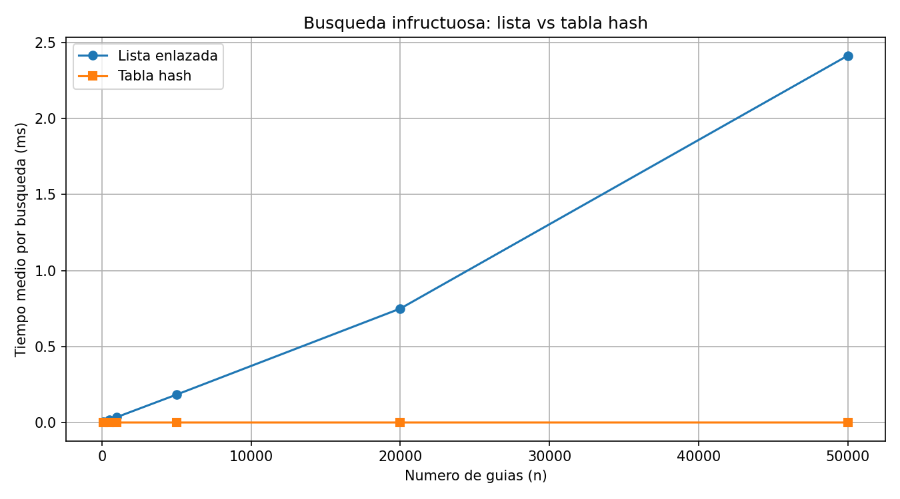
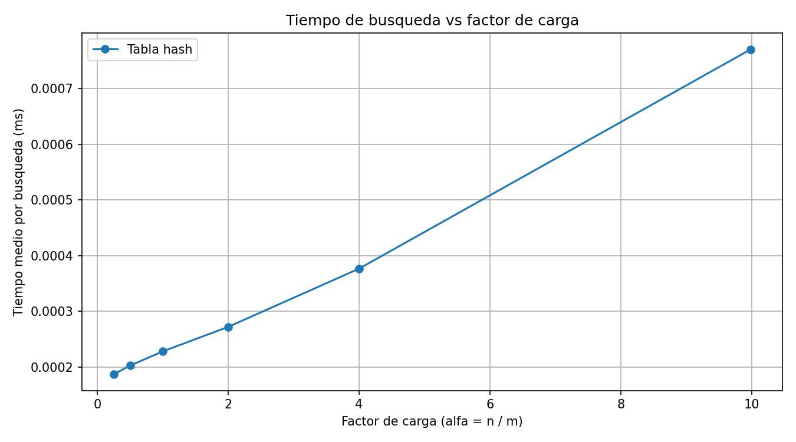

# Laboratorio 3 — Estructuras de datos

**Estudiante:** Juan Felipe Cadavid Zabala

## Cómo ejecutar el laboratorio

Para este laboratorio utilicé Python 3.12 y la biblioteca `matplotlib` para generar las gráficas. Esta biblioteca ya está registrada en `ejercicios-clase/semana-02/requirements.txt`, por lo que no modifiqué ese archivo.

Para trabajar con un entorno virtual llamado `.venv`, desde la raíz del repositorio se puede activar así:

**Windows (PowerShell):**
```powershell
.\.venv\Scripts\Activate.ps1
```

**Linux o macOS:**
```bash
source .venv/bin/activate
```

Estos comandos suponen que el entorno existe con ese nombre. Yo ejecuté las pruebas y mediciones directamente con Python.

Para instalar las dependencias registradas, desde la raíz:

```bash
python -m pip install -r ejercicios-clase/semana-02/requirements.txt
```

Después, dentro de la carpeta `lab3-estructuras-datos`, se ejecutan:

```bash
python pruebas.py
python medicion.py
```

El primer comando comprueba las estructuras y el segundo realiza los experimentos y genera las gráficas.

## Parte 1 — Implementación y pruebas

**Archivos:** [estructuras.py](estructuras.py) y [pruebas.py](pruebas.py)

En esta parte implementé una lista simplemente enlazada y una tabla hash con encadenamiento. En la lista, las guías se insertan al inicio y se buscan recorriendo los nodos. En la tabla hash, cada guía se asigna a una casilla utilizando el módulo y, cuando varias coinciden, se almacenan en una lista enlazada.

Para verificar que funcionaran, probé búsquedas exitosas e infructuosas. También comprobé que las guías 10, 24 y 17 quedaran en la casilla 3 de una tabla con 7 posiciones, que pudieran recuperarse y que el factor de carga fuera 3/7.

Finalmente, comparé ambas estructuras en 20 colecciones aleatorias, cada una con 50 guías existentes y 10 inexistentes. Todas las pruebas finalizaron correctamente.

## Parte 2 — Mediciones y gráficas

**Código:** [medicion.py](medicion.py)

Para los experimentos generé guías diferentes de diez dígitos utilizando la semilla 42. Las 200 guías inexistentes se generaron con semilla 7.

Medí únicamente las búsquedas con `time.perf_counter()`, sin incluir la creación de las estructuras. Para cada configuración hice tres repeticiones de 200 búsquedas, calculé el tiempo medio de cada repetición y tomé la mediana. Los resultados están en milisegundos por búsqueda.

### Experimento A — Lista frente a tabla hash

Probé seis tamaños de colección, utilizando las mismas guías en ambas estructuras. Para cada tamaño elegí un número primo de casillas cercano a n/2, manteniendo el factor de carga alrededor de 2.

| Guías (n) | Casillas (m) | Factor α | Lista (ms) | Hash (ms) |
|---:|---:|---:|---:|---:|
| 100 | 53 | 1,8868 | 0,003545 | 0,000242 |
| 500 | 251 | 1,9920 | 0,017723 | 0,000249 |
| 1.000 | 503 | 1,9881 | 0,035915 | 0,000263 |
| 5.000 | 2.503 | 1,9976 | 0,183678 | 0,000282 |
| 20.000 | 10.007 | 1,9986 | 0,749385 | 0,000289 |
| 50.000 | 25.013 | 1,9990 | 2,413090 | 0,000303 |



**Análisis de la Figura 1**

En la Figura 1 se observa que el tiempo de la lista enlazada aumenta claramente cuando crece la cantidad de guías. En cambio, la curva de la tabla hash permanece casi sobre el eje horizontal porque sus tiempos son mucho menores.

Entre 5.000 y 20.000 guías, la cantidad de elementos aumentó cuatro veces. El tiempo de la lista pasó de 0,183678 a 0,749385 ms, aumentando 4,08 veces, mientras que el de la tabla pasó de 0,000282 a 0,000289 ms, apenas 1,02 veces. Esto respalda el crecimiento lineal de la lista y el comportamiento aproximadamente constante de la tabla cuando α se mantiene cercano a 2.

También se observa que el último tramo de la lista es más pronunciado. Entre 20.000 y 50.000 guías, n aumentó 2,5 veces, pero el tiempo creció 3,22 veces. Esto indica que las mediciones reales no siguen exactamente la proporción teórica. Podrían influir las condiciones de ejecución o el uso de memoria, aunque con estos resultados no es posible asegurar la causa.

### Experimento B — Efecto del factor de carga

Mantuve 20.000 guías y cambié el número de casillas para observar cómo influye el factor de carga en las búsquedas.

| Guías (n) | Casillas (m) | Factor α | Hash (ms) |
|---:|---:|---:|---:|
| 20.000 | 80.021 | 0,2499 | 0,000187 |
| 20.000 | 40.009 | 0,4999 | 0,000203 |
| 20.000 | 20.011 | 0,9995 | 0,000228 |
| 20.000 | 10.007 | 1,9986 | 0,000272 |
| 20.000 | 5.003 | 3,9976 | 0,000376 |
| 20.000 | 2.003 | 9,9850 | 0,000771 |



**Análisis de la Figura 2**

En la Figura 2 se observa que el tiempo de búsqueda aumenta a medida que crece el factor de carga. Al principio, entre α = 0,2499 y α = 0,9995, los tiempos cambian poco, pasando de 0,000187 a 0,000228 ms.

Después la curva empieza a subir más claramente. Con α cercano a 4, la búsqueda tardó 0,000376 ms, mientras que con α cercano a 10 tardó 0,000771 ms, aproximadamente 2,05 veces más.

Esto ocurre porque, al mantener las mismas 20.000 guías y reducir las casillas, aumenta la cantidad promedio de nodos que deben revisarse en cada lista. La gráfica muestra que la tabla hash sigue siendo rápida, pero su rendimiento disminuye cuando aumenta α.

## Parte 3 — Análisis

### 1. Costo teórico

En una lista enlazada, buscar una guía inexistente obliga a recorrer todos los nodos antes de devolver `None`, por lo que su costo es Θ(n).

En una tabla hash con encadenamiento primero se calcula la casilla y después se busca dentro de su lista. Si las guías se distribuyen aproximadamente de manera uniforme, cada casilla tendrá en promedio α = n/m elementos. Por eso el costo esperado es Θ(1 + α).

Si todas las guías terminaran en la misma casilla, tendríamos una lista de n elementos y la búsqueda volvería a costar Θ(n) en el peor caso.

### 2. Lo medido frente a lo esperado

Como muestra la **Figura 1**, al pasar de 5.000 a 20.000 guías, la lista multiplicó su tiempo por 4,08 y la tabla hash por 1,02. Esto es coherente con Θ(n) para la lista y con un tiempo aproximadamente constante para la tabla cuando α se mantiene cercano a 2.

En la **Figura 2**, al aumentar α de aproximadamente 0,25 a 10, el tiempo pasó de 0,000187 a 0,000771 ms, es decir, aumentó unas 4,12 veces. Esto es coherente con Θ(1 + α), aunque los tiempos no crecen en la misma proporción que α debido al costo fijo de las operaciones.

### 3. Colisiones

Una colisión ocurre cuando dos guías diferentes producen el mismo índice. Esto puede suceder incluso si hay más casillas que guías, porque la función módulo no garantiza resultados distintos.

Por ejemplo, con m = 7, las guías 10, 24 y 17 producen residuo 3. Con encadenamiento, las tres se guardan en una lista dentro de esa casilla. Su ventaja es que permite almacenar varias guías en una misma posición; su costo es utilizar nodos adicionales y recorrerlos cuando sea necesario.

En el direccionamiento abierto se busca otra casilla disponible, por ejemplo mediante sondeo lineal. Esto evita las listas adicionales, pero puede generar agrupaciones de elementos y requiere controlar la ocupación de la tabla.

### 4. Tabla hash o árbol de búsqueda

La tabla hash funciona bien para buscar una guía exacta, pero no conserva las guías ordenadas. Para encontrar todas las que estén entre X y Y tendría que revisar la colección.

Un árbol de búsqueda binario permite aprovechar el orden y consultar un rango en Θ(h + k), donde h es la altura y k la cantidad de resultados.

Si insertamos 400.000 guías ya ordenadas en un árbol sin equilibrar, se formaría prácticamente una cadena con altura de 399.999 aristas. Durante las inserciones se acumularían aproximadamente:

400.000 × 399.999 / 2 = **79.999.800.000 comparaciones**.

En un árbol equilibrado, la altura sería cercana a log₂(400.000), alrededor de 19, y las inserciones tendrían un costo del orden de n log n, aproximadamente 7,4 millones como referencia de crecimiento. La diferencia muestra por qué conviene mantener equilibrado el árbol.

### 5. Recomendación para operaciones

Recomendaría combinar una tabla hash para buscar guías exactas con un árbol de búsqueda equilibrado para consultar rangos. Así cada estructura resuelve una necesidad diferente.

Para estimar el tiempo con 5.000.000 de envíos tomé como referencia la medición de 50.000 guías. En la lista enlazada, como la búsqueda infructuosa recorre todos los nodos y la curva muestra un crecimiento aproximadamente lineal, calculé:

2,413090 × (5.000.000 / 50.000) = **241,309 ms por búsqueda**.

En la tabla hash no sería correcto multiplicar el tiempo por 100, porque su costo esperado depende del factor de carga. Si aumentamos proporcionalmente el número de casillas para mantener α cercano a 2 y las guías se distribuyen uniformemente, tomaría como referencia **0,000303 ms por búsqueda**.

Estas cifras son **estimaciones**, no mediciones realizadas con cinco millones de guías. Los tiempos reales pueden variar por la memoria, la distribución de los datos y las condiciones del computador.
